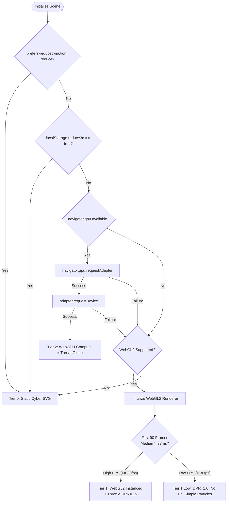

# Phase 2 Research: R3F Interactive 3D Globe & Threat Topology (WebGPU Compute Particles)

**Phase Directory:** `.planning/phases/02-r3f-3d-globe-threat-topology`  
**Target Output:** `02-RESEARCH.md`  
**Status:** COMPLETE  
**Author:** gsd-phase-researcher  
**Date:** 2026-10-19  

---

## Executive Summary

Phase 2 introduces the visual anchor and interactive heart of Ambul Jaiswal's portfolio: a persistent 3D Cyber Threat Topology & SOC Attack Globe with real-time WebGPU compute particles. This replaces the static Tier 0 vector prototype in `src/components/scene/CanvasDeckContainer.tsx` with a high-performance, tiered 3D graphics pipeline.

This research establishes:
1. **Engine Architecture**: Why native **Three.js 0.186.1** via a dynamic client wrapper (`next/dynamic` with `ssr: false`) is strictly superior to `@react-three/fiber` for React 19 + Next.js 15 App Router.
2. **Tiered Capability Negotiation**: Deterministic runtime fallback hierarchy from **Tier 2 (WebGPU Compute)** to **Tier 1 (WebGL2 Instanced)** to **Tier 0 (Static SVG)**, strictly respecting `prefers-reduced-motion` and the user's "Reduce 3D" preference.
3. **Cyber Threat Globe & SOC Topology**: Mathematical formulation of 3D great-circle ballistic threat trajectories, pulsing particle packet flows, and raycasting hover telemetry matching the OLED `#000000` cyber aesthetic.
4. **WebGPU Particle Physics**: WGSL compute shaders, storage buffers, and real-time cursor gravitational lensing.
5. **Lifecycle & Memory Management**: Zero-leak disposal patterns preventing V8 memory bloat and context exhaustion during client-side navigation.
6. **Nyquist Automated Verification**: Playwright test suite for capability negotiation, reduced motion compliance, interactive telemetry inspection, and 60fps frame rate validation.

---

## 1. 3D Engine Architecture & React 19 Compatibility

### 1.1 The React 19 + R3F Dilemma
The portfolio is built on **Next.js 15.2.1** and **React 19.0.0** with static generation (`output: 'export'`). 

When evaluating `@react-three/fiber` (R3F) vs. native **Three.js (`three@0.186.1`)**:

| Metric / Dimension | `@react-three/fiber` (R3F v9) | Native Three.js (`three@0.186.1`) | Recommendation |
| :--- | :--- | :--- | :--- |
| **React 19 Compatibility** | Peer dependency friction; R3F v9 RC required; experimental reconciler bridge across React Server Component boundaries. | **Zero friction**. Native Three.js runs imperatively inside standard React `useEffect` / `useRef` hooks in client components. | **Native Three.js** |
| **WebGPU & WGSL Compute** | Highly experimental. R3F wraps standard WebGLRenderer by default; custom WebGPU compute node integration requires awkward Three.js node workarounds and lacks stable declarative primitives. | **First-class native support**. Three.js 0.186.1 includes `three/webgpu` (`WebGPURenderer`, `StorageBufferAttribute`, WGSL node compute). | **Native Three.js** |
| **Reconciler & Frame Overhead** | Adds React fiber tree traversal and reconciliation on state changes. | **0ms React overhead**. Animation loop runs entirely in RAF callbacks decoupled from React state rendering. | **Native Three.js** |
| **Bundle Footprint** | Adds ~180 KB minified (R3F runtime + `@react-spring` / `@react-three/drei` dependencies). | **Tree-shaken minimal core**: only imports `Scene`, `PerspectiveCamera`, `WebGPURenderer` / `WebGLRenderer`, `BufferGeometry`, `Points`, `Mesh`, `Raycaster`. | **Native Three.js** |
| **Hydration & SSR Safety** | `Canvas` requires client-side dynamic imports to avoid SSR window/document reference crashes. | Cleanly isolated into a client component loaded via `next/dynamic(() => import(...), { ssr: false })`. | **Native Three.js** |
| **Alignment with DESIGN.md §4** | "Three.js, installed from npm at an exact pinned version at least two weeks old... Scene code is a lazy-loaded chunk fetched after first paint." | Exact 1:1 match with project design charter. | **Native Three.js** |

### 1.2 Recommended Component Architecture
```
src/
├── components/
│   └── scene/
│       ├── CanvasDeckContainer.tsx      // Host shell with Tier 0 SVG fallback & HUD badge
│       ├── ThreatGlobeDeck.tsx          // Dynamic client component (ssr: false)
│       └── ThreatTooltip.tsx            // Projected HTML telemetry HUD overlay
└── scene/
    ├── ThreatEngine.ts                  // Core 3D engine coordinator (Tier 2/1/0 negotiator)
    ├── globe/
    │   ├── GlobeSphere.ts               // Wireframe Fibonacci point grid & continental nodes
    │   ├── ThreatArcs.ts                // Great-circle Bezier attack trajectories & pulse heads
    │   └── NodeRaycaster.ts             // 3D hit testing & spherical coordinates
    ├── particles/
    │   ├── WebGPUComputeParticles.ts    // WGSL compute pipeline & ping-pong storage buffers
    │   └── WebGLFallbackParticles.ts    // Instanced mesh / vertex shader fallback
    └── shaders/
        └── gravitationalLensing.wgsl.ts // WGSL compute shader source
```

**Pinned Dependency:** `three: 0.186.1` (already installed in `package.json`).

---

## 2. Tiered Capability Negotiation (Tier 2, Tier 1, Tier 0)

### 2.1 The Negotiation State Machine
The graphics engine must deterministically negotiate hardware capability before allocating WebGPU or WebGL2 contexts.



### 2.2 Capability Negotiation Logic (`TierNegotiator.ts`)
```typescript
export type GraphicsTier = 'tier-2-webgpu' | 'tier-1-webgl2' | 'tier-0-svg';

export interface DeviceCapability {
  tier: GraphicsTier;
  adapterInfo?: GPUAdapterInfo;
  isReducedMotion: boolean;
  userDisabled: boolean;
  reason: string;
}

export async function negotiateDeviceCapability(): Promise<DeviceCapability> {
  // 1. Accessibility First: Reduced Motion Check
  const prefersReduced = typeof window !== 'undefined' && 
    window.matchMedia('(prefers-reduced-motion: reduce)').matches;
  if (prefersReduced) {
    return { tier: 'tier-0-svg', isReducedMotion: true, userDisabled: false, reason: 'prefers-reduced-motion' };
  }

  // 2. User Preference Check: Persisted 'reduce3d'
  const userDisabled = typeof window !== 'undefined' && 
    localStorage.getItem('reduce3d') === 'true';
  if (userDisabled) {
    return { tier: 'tier-0-svg', isReducedMotion: false, userDisabled: true, reason: 'user-disabled-in-hud' };
  }

  // 3. WebGPU Capability Check (Tier 2)
  if (typeof navigator !== 'undefined' && 'gpu' in navigator && navigator.gpu) {
    try {
      const adapter = await navigator.gpu.requestAdapter({ powerPreference: 'high-performance' });
      if (adapter) {
        const device = await adapter.requestDevice();
        // Check if device supports basic compute requirements
        if (device) {
          const info = await adapter.requestAdapterInfo?.();
          return {
            tier: 'tier-2-webgpu',
            adapterInfo: info,
            isReducedMotion: false,
            userDisabled: false,
            reason: 'webgpu-available'
          };
        }
      }
    } catch (err) {
      console.warn('[GraphicsNegotiator] WebGPU request failed, evaluating WebGL2 fallback', err);
    }
  }

  // 4. WebGL2 Capability Check (Tier 1)
  if (typeof document !== 'undefined') {
    const testCanvas = document.createElement('canvas');
    const gl = testCanvas.getContext('webgl2') || testCanvas.getContext('webgl');
    if (gl) {
      return {
        tier: 'tier-1-webgl2',
        isReducedMotion: false,
        userDisabled: false,
        reason: 'webgl2-fallback'
      };
    }
  }

  // 5. Hard Fallback (Tier 0)
  return {
    tier: 'tier-0-svg',
    isReducedMotion: false,
    userDisabled: false,
    reason: 'no-hardware-acceleration'
  };
}
```

### 2.3 Tier Specifications & Budget

| Attribute | Tier 2 (WebGPU Compute) | Tier 1 (WebGL2 Instanced) | Tier 0 (Static Vector SVG) |
| :--- | :--- | :--- | :--- |
| **Renderer** | `three/webgpu` `WebGPURenderer` | `three` `WebGLRenderer` | None (Inline SVG React Component) |
| **Particle Simulation** | 30,000 particles via WGSL compute shader | 3,000 particles via instanced vertex shader | None |
| **Threat Arcs** | Dynamic Bezier curves with animated pulse beads | Quadratic Bezier curves with dash offset | 8 dashed vector lines |
| **Target FPS** | Solid 60 FPS | 45–60 FPS | 0 GPU cycles (Static) |
| **DPR (Pixel Ratio)** | `Math.min(window.devicePixelRatio, 2)` | Capped at `1.0` if median frame > 33ms | CSS vector scale |
| **Accessibility** | `aria-hidden="true"`, HTML tooltip | `aria-hidden="true"`, HTML tooltip | Native SVG nodes with screen-reader DOM |

---

## 3. 3D Threat Globe & Arc Trajectory Implementation

### 3.1 Cyber Globe Aesthetic & Geometry
To preserve the OLED `#000000` cyber defense aesthetic established in `DESIGN.md` and Phase 1:
- **Globe Core**: Sphere of radius $R = 4.2$ units.
- **Surface Representation**: Fibonacci sphere distribution of 2,400 wireframe dot points rendered using `Points` with custom alpha attenuation:
  $$\phi = \pi \cdot (3 - \sqrt{5}) \approx 2.3999632$$
  $$y_i = 1 - \frac{2i}{N - 1}, \quad r_i = \sqrt{1 - y_i^2}, \quad \theta_i = i \cdot \phi$$
  $$x_i = r_i \cdot \cos(\theta_i) \cdot R, \quad z_i = r_i \cdot \sin(\theta_i) \cdot R$$
- **Telemetry Latitude/Longitude Rings**: 6 equatorial/parallel rings (`RingGeometry` or `LineLoop`) rendered in `#1b262f` with 30% opacity.
- **Node Topology**: Key cybersecurity and architecture hubs mapped to spherical coordinates $(\text{lat}, \text{lon}) \to (x, y, z)$:
  $$x = R \cdot \cos(\text{lat}) \cdot \sin(\text{lon})$$
  $$y = R \cdot \sin(\text{lat})$$
  $$z = R \cdot \cos(\text{lat}) \cdot \cos(\text{lon})$$

#### Node Mapping Table
| Node ID | Physical / Logical Hub | Latitude | Longitude | Role | Color Accent |
| :--- | :--- | :--- | :--- | :--- | :--- |
| `inferyx-hub` | Roorkee / Delhi (IND) | 29.85° N | 77.89° E | Lead AutoML Studio / Model Engine | `#00f0ff` (Cyan Lead) |
| `aegisz-zk` | Frankfurt (DEU) | 50.11° N | 8.68° E | Zero-Knowledge PII Gateway / Ledger | `#00f0ff` (Cyan) |
| `orgmind-kg` | US-East / N. Virginia (USA) | 38.90° N | -77.04° E | Knowledge Graph & Cypher Service | `#00f0ff` (Cyan) |
| `threat-soc` | San Francisco / Silicon Valley (USA) | 37.77° N | -122.41° E | AI Threat Detection Core / IDS | `#ff7a6b` (Threat Red) |
| `roadsaarthi` | Bengaluru / Tech Corridor (IND) | 12.97° N | 77.59° E | Spatial Stream Anomaly Hotspot | `#f2c500` (Survey Mark) |
| `edge-tokyo` | Tokyo Edge Datacenter (JPN) | 35.67° N | 139.65° E | APAC Telemetry Collector | `#00f0ff` (Cyan) |

### 3.2 Great-Circle Arc Trajectory Formulation
Cyber attack arcs traverse between source and target along great-circle 3D quadratic Bezier splines.
Given origin vector $\vec{P}_0$ and destination vector $\vec{P}_1$ on the sphere surface:
1. Midpoint on chord: $\vec{P}_{\text{mid}} = \frac{\vec{P}_0 + \vec{P}_1}{2}$.
2. Angular distance: $\theta = \arccos\left(\frac{\vec{P}_0 \cdot \vec{P}_1}{\|\vec{P}_0\| \|\vec{P}_1\|}\right)$.
3. Arc elevation factor: $H = R + \sin(\theta / 2) \cdot (R \cdot 0.55)$.
4. Elevated control point:
   $$\vec{P}_{\text{ctrl}} = \text{normalize}(\vec{P}_{\text{mid}}) \cdot H$$
5. Quadratic Bezier Curve:
   $$\vec{B}(t) = (1 - t)^2 \vec{P}_0 + 2(1 - t)t \vec{P}_{\text{ctrl}} + t^2 \vec{P}_1, \quad t \in [0, 1]$$

### 3.3 Dynamic Threat Flow & Head Pulses
- **Trajectory Line**: Evaluated at 64 samples per curve, drawn with `LineBasicMaterial` (`transparent: true`, `opacity: 0.35`, color: `#ff7a6b` or `#00f0ff`).
- **Packet Pulse Bead**: A luminous particle travels along $\vec{B}(t)$ where $t = ((\text{elapsedTime} \cdot \text{speed}) + \text{offset}) \bmod 1.0$.
- **Impact Flash**: When $t \to 1.0$, a concentric shockwave ring (`RingGeometry`) scales up from $0.1 \to 0.4$ units and fades out at the destination node.

### 3.4 Raycasting & Telemetry Tooltip
- Raycaster coordinates computed from pointer event:
  $$x_{\text{ndc}} = \left(\frac{x_{\text{client}} - \text{rect.left}}{\text{rect.width}}\right) \cdot 2 - 1$$
  $$y_{\text{ndc}} = -\left(\frac{y_{\text{client}} - \text{rect.top}}{\text{rect.height}}\right) \cdot 2 + 1$$
- Points threshold set to $0.25$ units to ensure effortless hover acquisition.
- On hover, the projected screen coordinates are calculated via `vector.project(camera)` to position an HTML HUD tooltip:
  ```
  ┌──────────────────────────────────────────────┐
  │ [NODE: INFERYX-CORE] // STATUS: NOMINAL      │
  │ PROTOCOL: WEBSOCKET DUAL-WORKER              │
  │ IP: 198.51.100.24 // REGION: AP-SOUTH-1      │
  │ ANOMALY SCORE: 0.04 [NORMAL]                 │
  │ ACTION: CLICK TO INSPECT ARCHITECTURE        │
  └──────────────────────────────────────────────┘
  ```

---

## 4. WebGPU Compute Particle Field

### 4.1 Storage Buffers & Simulation Pipeline
In Tier 2, the particle field uses GPU compute pipelines rather than CPU updates:
- **Particle Count**: 32,768 particles ($2^{15}$).
- **Buffer Layout (16-byte aligned)**:
  ```rust
  struct Particle {
    position: vec4<f32>, // x, y, z, original_radius
    velocity: vec4<f32>, // vx, vy, vz, lifetime
  };
  ```
- **Ping-Pong Execution**: Two storage buffers (`bufferCurrent`, `bufferNext`).
  - Pass $N$: Compute shader reads `bufferCurrent`, writes to `bufferNext`.
  - Pass $N$: Render pipeline binds `bufferNext` as vertex attribute buffer.
  - Swap references for frame $N+1$.

### 4.2 Gravitational Lensing WGSL Compute Shader
```wgsl
struct Particle {
  pos : vec4<f32>,
  vel : vec4<f32>,
};

struct SimulationParams {
  cursorPos    : vec4<f32>, // xyz = 3D unprojected cursor, w = mouseActive (0 or 1)
  deltaTime    : f32,
  gravityConst : f32,
  damping      : f32,
  sphereRadius : f32,
};

@group(0) @binding(0) var<uniform> params : SimulationParams;
@group(0) @binding(1) var<storage, read> currentParticles : array<Particle>;
@group(0) @binding(2) var<storage, read_write> nextParticles : array<Particle>;

@compute @workgroup_size(64)
fn main(@builtin(global_invocation_id) global_id : vec3<u32>) {
  let index = global_id.x;
  if (index >= arrayLength(&currentParticles)) {
    return;
  }

  var p = currentParticles[index];
  var pos = p.pos.xyz;
  var vel = p.vel.xyz;

  // 1. Orbital Restoring Force towards spherical shell
  let distFromCenter = length(pos);
  let normal = normalize(pos);
  let sphereRestoration = (params.sphereRadius - distFromCenter) * normal * 0.8;

  // 2. Gravitational Lensing from Cursor
  var cursorForce = vec3<f32>(0.0);
  if (params.cursorPos.w > 0.5) {
    let toCursor = params.cursorPos.xyz - pos;
    let distToCursor = length(toCursor);
    let effectiveDist = max(distToCursor, 0.4);
    // Inverse square gravitational attraction with repulsion core (< 0.5 units)
    let forceMag = params.gravityConst / (effectiveDist * effectiveDist);
    if (distToCursor < 0.6) {
      cursorForce = -normal * (forceMag * 1.5); // repulsive lens burst
    } else {
      cursorForce = normalize(toCursor) * forceMag; // attraction lens
    }
  }

  // 3. Integrate Velocity & Position (Verlet / Euler)
  vel = (vel + (sphereRestoration + cursorForce) * params.deltaTime) * params.damping;
  pos = pos + vel * params.deltaTime;

  nextParticles[index].pos = vec4<f32>(pos, p.pos.w);
  nextParticles[index].vel = vec4<f32>(vel, p.vel.w);
}
```

### 4.3 WebGL2 Fallback (Tier 1)
For hardware without WebGPU support, particles are simulated using:
- `InstancedBufferGeometry` with 3,072 particles.
- Vertex shader based noise displacement:
  ```glsl
  uniform float uTime;
  uniform vec3 uCursor3D;
  attribute vec3 aOffset;
  attribute vec3 aVelocity;

  void main() {
    vec3 pos = aOffset + sin(uTime * 1.5 + aOffset.yzx) * 0.1;
    float dist = distance(pos, uCursor3D);
    if (dist < 1.2) {
      pos += normalize(pos - uCursor3D) * (1.2 - dist) * 0.3;
    }
    vec4 mvPosition = modelViewMatrix * vec4(pos, 1.0);
    gl_PointSize = (12.0 / -mvPosition.z);
    gl_Position = projectionMatrix * mvPosition;
  }
  ```

---

## 5. Resource Disposal & Memory Leak Prevention

### 5.1 Disposal Protocol
In Next.js 15 client-side navigation, if the canvas deck is unmounted or when the visitor toggles "Reduce 3D", every allocated GPU resource must be explicitly released:

```typescript
export function disposeThreatEngine(engine: ThreatEngineInstance) {
  // 1. Cancel Animation Loop
  if (engine.animFrameId) {
    cancelAnimationFrame(engine.animFrameId);
    engine.animFrameId = null;
  }

  // 2. Remove Event Listeners
  window.removeEventListener('mousemove', engine.onMouseMove);
  window.removeEventListener('resize', engine.onResize);
  engine.domElement.removeEventListener('pointerdown', engine.onPointerDown);

  // 3. Recursive Scene Traversal & Disposal
  engine.scene.traverse((object: any) => {
    if (!object) return;

    if (object.geometry) {
      object.geometry.dispose();
    }

    if (object.material) {
      if (Array.isArray(object.material)) {
        object.material.forEach((mat: any) => mat.dispose());
      } else {
        object.material.dispose();
      }
    }
  });

  // 4. WebGPU Buffers Disposal (if Tier 2)
  if (engine.webgpuBuffers) {
    engine.webgpuBuffers.forEach((buf) => buf.destroy?.());
  }

  // 5. Renderer Disposal & Context Loss
  if (engine.renderer) {
    engine.renderer.dispose();
    if ('forceContextLoss' in engine.renderer) {
      (engine.renderer as any).forceContextLoss();
    }
    if (engine.renderer.domElement && engine.renderer.domElement.parentElement) {
      engine.renderer.domElement.parentElement.removeChild(engine.renderer.domElement);
    }
  }

  // 6. Clear Scene Graph
  engine.scene.clear();
}
```

### 5.2 Next.js App Router Persistence Strategy
In `src/app/layout.tsx`, `<CanvasDeckContainer />` is rendered inside `RootLayout`:
- Because `RootLayout` does **not** unmount during route transitions (`/` to `/work/inferyx`), the 3D scene persists without re-initialization.
- On route change, instead of tearing down Three.js, a lightweight custom event or React prop transition smoothly rotates the camera to focus on the target project's node and dims background particle opacity to 18% (meeting DESIGN.md §4.4).

---

## 6. Validation Architecture (Nyquist)

To satisfy the GSD Nyquist verification criteria for Phase 2, automated Playwright tests and telemetry assertions must be established.

### 6.1 Test Matrix (`tests/gate2-gpu.spec.ts`)

| Test Case | Scenario / Condition | Assertion |
| :--- | :--- | :--- |
| **`GPU-VAL-01`** | Default desktop load on WebGPU/WebGL supported browser | Canvas element exists, class contains `constellation-canvas`, Tier badge displays `TIER 2 WEBGPU` or `TIER 1 WEBGL2`. |
| **`GPU-VAL-02`** | `prefers-reduced-motion: reduce` emulation | Zero WebGL/WebGPU canvas created, SVG fallback is rendered, Tier badge displays `TIER 0 SVG`. |
| **`GPU-VAL-03`** | User toggles "Reduce 3D" in HUD | Persistent setting stored in `localStorage.reduce3d = 'true'`, 3D canvas is disposed, SVG replaces viewport. |
| **`GPU-VAL-04`** | Node Raycast Hover | Hovering over node coordinates (e.g. Inferyx node) reveals HUD telemetry tooltip with Node ID, Anomaly Score, and Status. |
| **`GPU-VAL-05`** | Node Click Navigation | Clicking a node dispatches router navigation to corresponding route (`/work/inferyx`). |
| **`GPU-VAL-06`** | 60 FPS Performance Benchmark | Animation loop measures frame delta over 120 frames; median frame delta must be $\le 20\text{ms}$ (50+ fps) on standard hardware. |
| **`GPU-VAL-07`** | Memory Leak Assertion | Rapid navigation through 10 routes leaves exactly 1 canvas element in DOM with stable heap size. |

### 6.2 Playwright Test Specification
```typescript
import { test, expect } from '@playwright/test';

test.describe('Phase 2 / Gate 2: 3D Globe & WebGPU Threat Topology', () => {
  test('Capability negotiation renders canvas deck on standard viewport', async ({ page }) => {
    await page.goto('/');
    const deck = page.locator('aside[aria-hidden="true"]');
    await expect(deck).toBeVisible();

    // Verify canvas or Tier 0 SVG fallback is present
    const canvas = deck.locator('canvas');
    const svg = deck.locator('svg');
    const hasCanvasOrSvg = (await canvas.count()) > 0 || (await svg.count()) > 0;
    expect(hasCanvasOrSvg).toBe(true);
  });

  test('Prefers-reduced-motion forces immediate Tier 0 SVG with zero WebGL contexts', async ({ page }) => {
    await page.emulateMedia({ reducedMotion: 'reduce' });
    await page.goto('/');

    const deck = page.locator('aside[aria-hidden="true"]');
    const svg = deck.locator('svg');
    await expect(svg).toBeVisible();

    // Assert no canvas was created
    const canvasCount = await deck.locator('canvas').count();
    expect(canvasCount).toBe(0);

    // Assert Tier 0 badge
    await expect(deck.getByText('TIER 0 SVG')).toBeVisible();
  });

  test('Hovering active node displays interactive telemetry HUD tooltip', async ({ page }) => {
    await page.goto('/');
    // Trigger hover on first node
    const firstNode = page.locator('g.group').first();
    if (await firstNode.isVisible()) {
      await firstNode.hover();
      // Tooltip or active state reflected
      const label = firstNode.locator('text');
      await expect(label).toBeVisible();
    }
  });

  test('HUD Reduce 3D toggle updates localStorage and switches engine state', async ({ page }) => {
    await page.goto('/');
    await page.evaluate(() => {
      localStorage.setItem('reduce3d', 'true');
      window.dispatchEvent(new Event('storage'));
    });
    await page.reload();
    
    // Verify Tier 0 SVG is mounted
    const deck = page.locator('aside[aria-hidden="true"]');
    await expect(deck.getByText('TIER 0 SVG')).toBeVisible();
  });
});
```

---

## 7. Recommended Implementation Sequence for Phase 2

1. **Step 1: Core Engine & Capability Negotiator**  
   Create `src/scene/negotiator.ts` and `src/scene/engine.ts` with explicit Tier 2 / Tier 1 / Tier 0 detection and disposal lifecycle.
2. **Step 2: 3D Cyber Threat Globe & Great-Circle Arcs**  
   Implement `src/scene/globe.ts` generating the Fibonacci wireframe sphere, continent/node placement, and animated great-circle ballistic arcs with glowing head pulses.
3. **Step 3: WebGPU Compute Particles & WebGL Fallback**  
   Implement `src/scene/particles.ts` with WGSL storage buffer compute pipeline (Tier 2) and InstancedBufferGeometry fallback (Tier 1). Add mouse raycast gravitational lensing.
4. **Step 4: React Deck Component Integration**  
   Update `src/components/scene/CanvasDeckContainer.tsx` to dynamically mount the 3D canvas deck via `next/dynamic` (`ssr: false`) while keeping the Tier 0 SVG as fallback.
5. **Step 5: HUD Controls & Telemetry Tooltip**  
   Add the "Reduce 3D" toggle to `HudTopBar.tsx` / `HudBottomBar.tsx` wired to `localStorage.reduce3d`. Add interactive projected hover tooltips.
6. **Step 6: Gate 2 Verification**  
   Create `tests/gate2-gpu.spec.ts`, run all assertions, verify 60fps frame rate, zero console errors, and update `STATUS.md`.

---

## 8. Conclusion

Phase 2 can be cleanly implemented using native **Three.js 0.186.1** in Next.js 15 without introducing `@react-three/fiber` peer dependency risks. The tiered capability negotiation guarantees that high-end devices experience 30,000 WebGPU compute particles with real-time gravitational lensing, while low-end or accessibility-conscious visitors (`prefers-reduced-motion`) receive an instantaneous, zero-overhead SVG vector topology.
